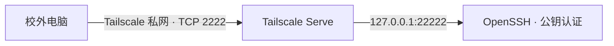

# Notebook Tailbridge

**在校外用 SSH 访问 Linux Notebook 的私有连接工具包。**

[下载 v1.0.0 脚本包](https://github.com/muliuqing999/notebook-tailbridge/raw/refs/heads/main/notebook-tailbridge-v1.0.0.zip) · [部署步骤](#1-下载并启动-tailscale)

适用于学院允许远程访问、容器没有 `/dev/net/tun` 的场景。校外电脑通过 Tailscale 私有网络连接 TCP 2222，Tailscale Serve 再把连接转给容器内 `127.0.0.1:22222` 上的 OpenSSH。



| 文件 | 用途 |
|---|---|
| [start.sh](start.sh) | 启动用户态 Tailscale，检查本地服务是否就绪 |
| [map-ssh.sh](map-ssh.sh) | 检查回环 SSH 端口并设置私有 TCP 映射 |
| [sshd_config.example](sshd_config.example) | 独立 OpenSSH 配置示例，包含认证和转发设置 |

| 在哪里操作 | 用什么 |
|---|---|
| 学院平台的 Linux Terminal | 启动 Tailscale、配置 SSH、查看状态 |
| Tailscale 管理后台 | 批准设备并限定 TCP 2222 的访问对象 |
| 校外电脑 | 登录同一个 Tailscale 网络，用 SSH 公钥登录 |

## 1. 下载并启动 Tailscale

在 Linux 终端用 `uname -m` 查架构，从 [Tailscale 官方稳定版下载页](https://pkgs.tailscale.com/stable/) 选择相应的 Linux 压缩包。比较 `sha256sum 压缩包文件名` 与官方校验值，再用 `tar -xzf 压缩包文件名` 解压。在解压后的目录运行：

```bash
install -d -m 700 "$HOME/.local/share/tailscale-private-ssh/bin"
install -m 755 tailscale tailscaled "$HOME/.local/share/tailscale-private-ssh/bin/"
```

回到本教程脚本所在目录，在 Linux 终端运行：

```bash
sh start.sh
access_dir="$HOME/.local/share/tailscale-private-ssh"
"$access_dir/bin/tailscale" --socket="$access_dir/tailscaled.sock" up \
  --hostname=notebook-private-ssh --accept-dns=false --accept-routes=false
```

打开命令给出的链接，用校外电脑所在网络的账号授权服务器。需要管理员审批时，等设备获准后再继续。用 `status` 查状态，用 `ip -4` 查地址，两条命令都带上相同的 `--socket` 参数。设备身份保存在 `tailscaled.state` 中，分享文件时仅分享教程和脚本。

## 2. 准备仅接受公钥的 SSH 入口

如果管理员已经提供了同一容器内的密钥 SSH 服务，可以跳到第三步，把它的端口填入 `LOCAL_PORT`。如需单独启动 OpenSSH，使用 [配置示例](sshd_config.example)，由有权限的服务器管理员操作。按平台给你的普通用户设置登录账号，把校外电脑的 SSH 公钥加入该用户的 `~/.ssh/authorized_keys`，并核对目录归属及权限。校外电脑可用 `ssh-keygen -t ed25519` 生成自己的密钥，复制时只取 `.pub` 文件。

以下命令假设已把示例放在当前目录、系统已具备 OpenSSH 服务端和 ED25519 主机密钥，并用管理员终端执行。第一条校验配置，第二条再启动独立服务。

```bash
/usr/sbin/sshd -t -f "$PWD/sshd_config.example"
/usr/sbin/sshd -f "$PWD/sshd_config.example"
ss -lnt
ssh-keygen -lf /etc/ssh/ssh_host_ed25519_key.pub
```

确认端口只监听 `127.0.0.1:22222`。记下通过学院终端查到的主机指纹，供首次连接时核对。

## 3. 添加私有映射并从校外验收

在 Tailscale 管理后台检查访问策略，限定到自己的校外设备或指定身份以及目标 TCP 端口。然后在服务器执行：

```bash
LOCAL_PORT=22222 TAILNET_PORT=2222 sh map-ssh.sh
```

脚本先检查服务器已取得 Tailscale IPv4，并向本地 SSH 服务读握手标识，再设置映射和打印状态。校外电脑在家用网络或手机热点测试。将地址、用户名和密钥路径替换成自己的值：

```powershell
$serverIp = '这里填服务器的 Tailscale IPv4'
$keyPath = "$env:USERPROFILE\.ssh\id_ed25519_school"
ssh -p 2222 -i $keyPath "你的用户名@$serverIp"
```

首次连接时，比较提示的指纹和第二步记录的指纹，一致后再接受。登录后运行 `hostname`、`whoami` 和 `pwd` 核对目标。传文件用 `scp -P 2222`。VS Code Remote-SSH 使用同样的主机地址、端口、用户名和密钥。需要访问服务器上已运行的 Jupyter 时，可以在 SSH 命令中添加 `-N -L 8890:127.0.0.1:8888`，保持终端运行，再在浏览器打开 `http://127.0.0.1:8890`。Jupyter 本身的认证仍按原设置处理。

| 现象 | 检查 |
|---|---|
| `NeedsLogin` | 服务器设备是否已登录并获批 |
| 连接超时 | 校外电脑是否在同一个网络，策略是否放行 TCP 2222，Serve 是否启用 |
| `Connection refused` | 本地 SSH 服务是否监听，映射的目标端口是否正确 |
| `Permission denied (publickey)` | 用户名、公钥授权及客户端所选私钥是否对应 |
| 指纹变化 | 从学院终端重新核验主机指纹，确认实例是否重建 |

实例重启后先启动本地 SSH 服务和 Tailscale，再查询映射状态。旧实例被清理后，新实例需要重新配置及授权。要撤销本教程默认端口的映射，在服务器运行：

```bash
access_dir="$HOME/.local/share/tailscale-private-ssh"
"$access_dir/bin/tailscale" --socket="$access_dir/tailscaled.sock" serve --tcp=2222 off
```

本教程取自实际容器配置经验。原实例通过校内路径验证了独立 SSH 入口。服务器登录 Tailscale 和校外端到端连接在整理时仍待验证。公开脚本采用普通用户登录示例，需按平台配置验收。
